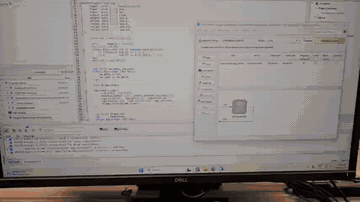
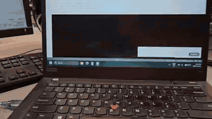
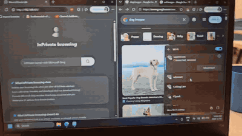
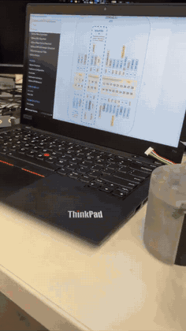

# Abderrahmene Naceri

Electrical engineering student at the University of Windsor building robotics, embedded and FPGA hardware.

**Live portfolio: [anaceri26.github.io](https://anaceri26.github.io)** · [LinkedIn](https://www.linkedin.com/in/abderrahmene-naceri) · [PDF portfolio](Abderrahmene_Naceri_Project_Portfolio.pdf)

| VGA frame buffer on a MAX 10 FPGA | FPGA-to-Arduino I2C link |
|---|---|
|  |  |
| **Edge AI cat/dog classifier on an ESP32-S3** | **Rover arm: BLDC motor on an ODrive S1** |
|  |  |

## Updating the site

- Single page, no build step: everything is in `index.html`.
- Projects live in the `P` array in the `<script>` at the bottom; Rover, Formula SAE and the lab are in `F`. Each entry lists its media (`m`), key numbers (`sp`) and sections (`sec`).
- Images go in `img/`, videos and their poster frames in `media/`.
- Replace `Abderrahmene_Naceri_Project_Portfolio.pdf` to update the PDF linked from the site.
